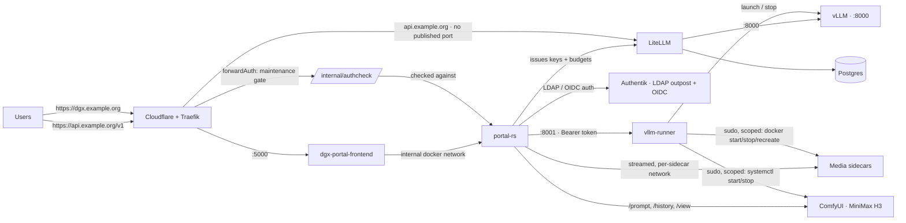

# Architecture

How the platform is wired: the request path, the components, and the shape of
the code. For how to run it, see [deployment](deployment.md); for the
day-to-day runbook, [operations](operations.md).

## Request path



> **The backend is `portal-rs/` (Rust).** It serves every route and job; the
> Flask backend it replaced was removed on 2026-10-17. See [Repository layout](#repository-layout).

### Components

| Component | Role | Port | Runs as |
|---|---|---|---|
| **litellm** | OpenAI-compatible gateway: per-user keys, budgets, token accounting | `4001` | Docker container |
| **litellm-postgres** | LiteLLM database (keys, spend logs) | `5432` (internal) | Docker container |
| **dgx-portal-frontend** | The UI (Next.js + Astryx): login, home, playground, media pages, support, find-a-model, leaderboard, admin, users (keys and memory live in the Settings dialog) | `5000` | Docker container (non-root) |
| **portal-rs** | Backend (Rust): LDAP/OIDC auth, sessions, JSON API, business logic, jobs | internal only | Docker container (non-root) |
| **vllm-runner** | Daemon driving **one** chat model process (start/stop/logs; engines `vllm` / `llamacpp` / `ds4`) with auto-resume, plus scoped start/stop/recreate of every media sidecar | `8001` | systemd service on the host |
| **vLLM** | OpenAI-compatible inference server (the main chat engine) | `8000` | process spawned by the runner |
| **OCR container** | vLLM serving an OCR-capable VLM (baidu/Unlimited-OCR by default, chandra-ocr-2 also supported), swappable via an admin catalog | internal only | Docker container, own network + GPU slice |
| **ComfyUI** | Video generation graph engine (MiniMax H3 in **NVFP4** — the Blackwell-native 4-bit format the GB10 supports; measured on disk: 11.7 GiB ≈ 12.5 GB per UNET, two UNET variants) | `8188`, host-restricted | systemd service on the host |
| **Image container** | Text-to-image (diffusers). FLUX.2 Klein 4B by default, 35 diffusion steps per image (`IMAGE_STEPS`) | internal only | Docker container, own network + GPU slice |
| **ASR container** | Whisper (`large-v3-turbo` by default) for Playground dictation | internal only | Docker container, own network + GPU slice |
| **Voice container** | Zero-shot voice cloning. Two interchangeable engines: **Qwen3-TTS** (default, Apache 2.0, 10 languages, 3 s cloning) or **Chatterbox** (MIT) | internal only | Docker container, own network + GPU slice |
| **SearXNG + crawl4ai** | Web search for the playground: SearXNG finds links, crawl4ai reads the pages | internal only | Docker containers, shared `web_net` |

> Only one **chat** model runs on the GPU at a time (launching another replaces the
> current one) — the media sidecars are separate, always-addressable backends running
> alongside it, each with its own GPU memory budget. On a single 128 GB unified-memory
> box that budget is genuinely shared: if a launch fails with an out-of-memory error,
> stop a sidecar from **Admin** rather than shrinking the chat model.

The UI used to be server-rendered Jinja templates served directly by Flask on
`:5000`. It's now a separate Next.js/Astryx frontend that owns `:5000` and
talks to `portal-rs` over the internal docker network for everything — auth, data
and the streaming chat endpoints (proxied through dedicated Next.js
Route Handlers so token-by-token streaming isn't buffered). The Flask backend that
used to sit behind it was removed on 2026-10-17.

## Repository layout

```
.
├── install.sh                 # one-shot host bootstrap (packages + systemd + .env)
├── setup.sh                   # generates .env with random secrets
├── docker-compose.yml         # postgres + litellm + portal-rs + frontend + search sidecars
├── .env.example               # placeholders (no real secrets)
├── README.md · SECURITY.md
├── litellm/config.yaml        # proxy, router and callback settings (the model
│                              #   catalog itself lives in the LiteLLM database)
├── portal-rs/                 # Rust backend (every route and job) — see the module list below
├── dgx-portal-frontend/       # Next.js + Astryx UI (owns the public port 5000)
├── vllm-runner-rs/            # model lifecycle daemon (Rust) + scoped sidecar control
├── monitoring/                # host monitors: health alerts + daily DB dumps (systemd timers)
├── needrestart/               # needrestart policy (keeps vllm-runner out of its restarts)
├── ocr/ · voice/ · voice-qwen/ · asr/ · image-gen/   # sidecar images and host wrappers
├── searxng/settings.yml.example  # web-search config template (setup.sh writes the real one)
└── systemd/                   # host units (runner, firewalls, ComfyUI, recreate scripts)
```

### Backend (`portal-rs/`)

One Rust crate: `portal-rs/src/` holds one module per concern (auth, sessions,
LiteLLM and vLLM clients, the sidecars, media jobs, admin) and `handlers/` the
HTTP routes. The ComfyUI video graphs are compiled in from `portal-rs/workflows/`.
Tests run with `cargo test --locked` in `portal-rs/`.

### Frontend (`dgx-portal-frontend/`)

Next.js 16 + Astryx. `app/(app)/` holds the pages, `lib/` the data helpers and the
i18n dictionary, `proxy.ts` the per-request nonce CSP and method-based routing, and
`lib/sseProxy.ts` the streaming relay to `portal-rs`. It has its own `README.md` and
`AGENTS.md` — start there for UI work.

> The `/usr/local/sbin/*-recreate.sh` wrappers and `/etc/sudoers.d/vllmrunner-*`
> live on the host (root-owned). Their tracked sources are `ocr/ocr-recreate.sh`,
> `voice/voice-recreate.sh`, `asr/asr-recreate.sh`, `voice-qwen/voice-qwen-recreate.sh`,
> `voice-kyutai/voice-kyutai-recreate.sh`,
> `systemd/image-recreate.sh` and `systemd/ocr-restrict.sh`; install with e.g.
> `install -o root -g root -m 0755 ocr/ocr-recreate.sh /usr/local/sbin/`.
